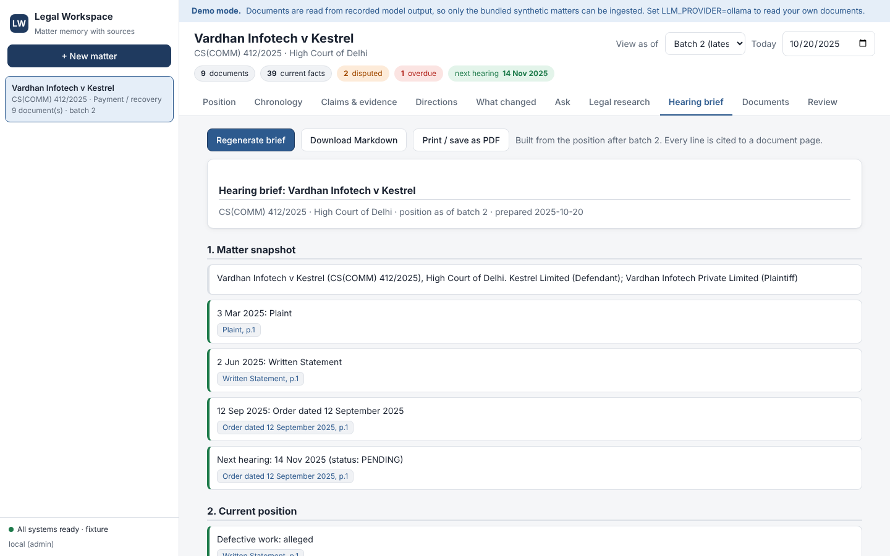

# Legal Workspace — persistent, evidence-grounded matter memory

A locally runnable, open-source, zero-cost implementation of the *Legal Workspace* RAG problem (Indian commercial / contract litigation): upload case files in batches and the system keeps a **memory of the matter** — what is true *now*, what it replaced and why, what changed in the last batch, which court directions are due — and answers questions with **every sentence cited and verified against the source page**.



| | |
| --- | --- |
| Problem statement | [`docs/source/HACKATHON_BRIEF.pdf`](docs/source/HACKATHON_BRIEF.pdf) |
| Architecture blueprint (input) | [`docs/source/ARCHITECTURE_BLUEPRINT_v3.md`](docs/source/ARCHITECTURE_BLUEPRINT_v3.md) |
| My review / deviations | [`docs/ARCHITECTURE_REVIEW.md`](docs/ARCHITECTURE_REVIEW.md) |
| How it was built (AADLC) | [`docs/AADLC.md`](docs/AADLC.md) → per-section spec · plan · report in [`docs/sections/`](docs/sections) |
| Deployment plan (DevOps) | [`docs/DEPLOYMENT_PLAN.md`](docs/DEPLOYMENT_PLAN.md) |
| Testing guide | [`docs/TESTING.md`](docs/TESTING.md) |

> **Status, honestly.** 591 backend tests + 44 UI tests + a Playwright browser flow pass; ruff and mypy are clean; the evaluation harness scores 37/37 golden questions and 23/23 planted changes **in fixture mode**.
> Fixture mode replays recorded model output, so it proves the pipeline, rules, grounding and UI — **not** how well a real small LLM reads your documents. I could not run Ollama/vLLM or Docker in the build sandbox, so those paths were written and unit-tested with mocks but **never run end to end**. Do step 2 below and read the numbers `lw-eval` gives you. The bundled legal corpus is paraphrased and **UNVERIFIED** — do not rely on it for legal work.

---

## 1. Try it in 5 minutes (no model, no cost)

Needs: Python ≥ 3.11, Node ≥ 20, PostgreSQL 16 with the `pgvector` extension (easiest: Docker).

```bash
git clone https://github.com/pavan-kodati/rag-learning && cd rag-learning
docker compose up -d db          # PostgreSQL 16 + pgvector  (or use your own; set DATABASE_URL)
make setup                       # venv, Python deps, UI deps + build
make demo                        # loads synthetic matter M2 (2 batches), serves API + UI → http://localhost:8000
```

Open <http://localhost:8000>, pick **Vardhan Infotech v Kestrel**, and try: *Gist* → *What changed* (batch 2) → click any citation (the PDF opens with the quote highlighted) → *As-of batch 1* → *Directions* → *Ask* "What amount is unpaid?" → *Hearing brief*. API docs: <http://localhost:8000/api/docs>.

You can also upload your own PDFs/DOCX/EML: in demo mode the "model" only knows the synthetic documents, so for your files use step 2.

## 2. Run with real open-source models (Ollama)

```bash
# install Ollama from https://ollama.com/download, then:
scripts/pull_models.sh           # qwen3:8b + qwen3:4b + bge-m3 (~9 GB).  "scripts/pull_models.sh small" for ≤ 8 GB RAM
cp .env.example .env             # defaults already select Ollama
make api                         # http://localhost:8000 (ingestion worker runs inside the API process)

# measure what your models can really do (the part I could not run for you):
.venv/bin/python -m legal_workspace.eval.runner --matters M1 M2 M3 M4
```
Report is written to `eval_reports/`. M4 has no recorded answers, so it is the honest test. If a model is unreachable the API still answers from facts using the model-free extractive fallback (flagged in the response and in metrics).

Whole stack in containers: `docker compose up --build` → UI <http://localhost:8080>, API <http://localhost:8000/docs>. (Containers: unverified here, see the deployment plan.)

## 3. Run the tests

```bash
docker compose exec db createdb -U lw legal_workspace_test
export TEST_DATABASE_URL=postgresql://lw:lw@localhost:5432/legal_workspace_test   # WARNING: its public schema is dropped by the suite
make test lint typecheck         # pytest, ruff, mypy
(cd ui && npm test && npm run lint && npm run typecheck)
```
Details, the negative-path map and known gaps: [`docs/TESTING.md`](docs/TESTING.md).

---

## RAG in 10 minutes (for the newcomer)

**Plain RAG** = split documents into *chunks* → turn each chunk into a vector (*embedding*) → at question time find the nearest chunks → give them to an LLM → it writes an answer. It works for "what does this document say?". It fails for litigation because:

1. **Time and authority:** an amendment replaces a clause, a court order replaces an earlier direction, a payment narrows a claim, a pleaded fact is *disputed*, not overwritten. Nearest-chunk search returns the old and new text side by side and the LLM guesses.
2. **Trust:** an LLM can write a fluent sentence that no document supports. A lawyer needs a page-level citation, not a vibe.

So this project is **RAG + a memory that is maintained by code**:

```
 files ─► parse/OCR ─► classify ─► chunk+embed ─► extract candidate facts (LLM, JSON only)
                                                           │  validated in code (quote on page? slot allowed? value parses?)
                                                           ▼
        batch commit ─► RECONCILE: authority rules R0–R9 decide what is current/superseded/disputed (no LLM)
                                                           ▼
                               matter memory: facts + links + change ledger + court directions + review queue
 question ─► router ─► one of 8 retrieval plans (structured facts first, passages second, as-of a batch)
          ─► LLM words the answer ─► CITATION VERIFIER in code: drop any sentence it cannot prove ─► answer
```

Key design rules: **models read, code decides** · every fact keeps a verbatim quote + page · nothing is silently overwritten (ledger) · unsure ⇒ review queue, not a guess · documents are data, never instructions.

## What you get

* **Ingestion:** PDF (digital + scanned via Tesseract), DOCX, EML (attachments become documents), TXT, images; content-based validation; per-file failure isolation.
* **Matter memory:** current / superseded / disputed facts with the rule that decided; as-of any batch; What-Changed report; computed court deadlines with compliance matching; derived outstanding amount; human review queue with audit trail.
* **Q&A:** 8 retrieval plans, hybrid search (dense + full-text, RRF, optional reranker), verified citations, hearing brief (8 sections), legal research tab over a separate corpus.
* **Enterprise layer:** JWT roles, rate limiting, problem+json errors with request ids, audit log, Prometheus metrics, health probes, JSON logs, migrations, Docker/compose/CI, k8s outline.
* **UI:** React + TypeScript: click-to-source highlight, state badges, batch time-travel, review queue.

## Decisions I took for you (you asked me to)

| Topic | Choice | Why |
| ----- | ------ | --- |
| Database | PostgreSQL 16 + pgvector | one transactional store for facts, vectors, queue, ledger |
| LLM (local) | Qwen3-8B / Qwen3-4B via Ollama | free, open weights (Apache-2.0), JSON-schema output, runs on a laptop; vLLM for GPUs |
| Embeddings | BGE-M3 (MIT, 1024-d) via Ollama; offline hashing fallback | multilingual, strong retrieval; fallback keeps tests/demo model-free |
| Orchestration | plain Python, no LangChain/agents | typed plans are easier to test and explain |
| API / UI | FastAPI (sync) / React + Vite | boring and reliable |

Full list of departures from the blueprint and why: [`docs/ARCHITECTURE_REVIEW.md`](docs/ARCHITECTURE_REVIEW.md).

## Repository map

```
src/legal_workspace/
  domain/      pure rules: normalisers, fact keys, authority R0–R9, deadlines      (S01)
  db/          schema, migrations, repositories, job queue                          (S02)
  adapters/    LLM / embedder / reranker ports, resilience, fixtures                (S03)
  ingestion/   validate, convert, OCR, classify, chunk, extract, service            (S04)
  memory/      reconcile, directions, events, queries, reports, review              (S05)
  retrieval/   hybrid search, router, eight plans                                   (S06)
  grounding/   answer, citation verification, hearing brief                         (S07)
  corpus/      legal corpus loader/search (separate schema)                         (S08)
  api/         FastAPI app, security, metrics, routes                               (S09)
  synthetic/   matter generator (M1–M4)  ·  eval/  scoring harness                  (S11)
ui/            React app, unit tests, Playwright flow                               (S10)
deploy/        prod compose overlay, Caddyfile, backup, k8s outline                 (S12)
data/          synthetic matters + gold answers, fixtures, corpus seed
docs/          AADLC, per-section spec/plan/report, review, deployment, testing
tests/         unit · integration · e2e
```

## Configuration

Every setting has a working default; see [`.env.example`](.env.example). Important ones: `LLM_PROVIDER` (`ollama` | `openai_compat` | `fixture`), `EMBEDDER` (`ollama` | `hashing`), `RERANKER`, `AUTH_ENABLED` (+ `JWT_SECRET`, `AUTH_USERS`), `WORKSPACE_TODAY` (pin "today" to demo overdue directions), `EMBEDDED_WORKER`.
**Auth is off by default for local testing — turn it on for anything shared.**

## Known limitations

Real-LLM accuracy unmeasured here · Docker/Kubernetes/CI-on-GitHub artefacts never executed · legal corpus is an UNVERIFIED seed · synthetic evaluation written by the same author · no tenant isolation, SSO or S3 storage · deadline arithmetic ignores court holidays and limitation law · not legal advice.
